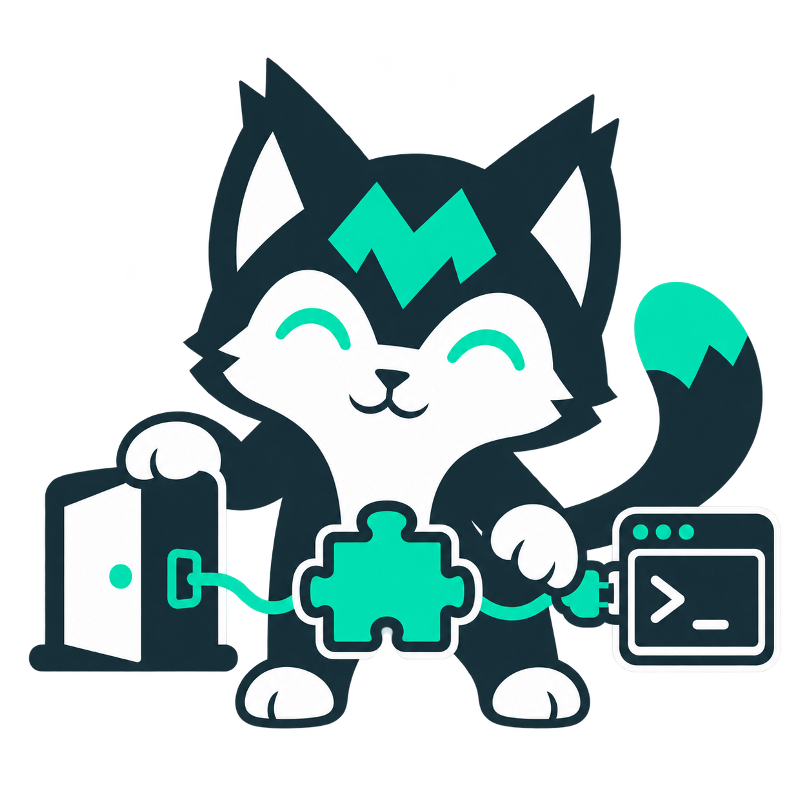

#  SharpMUSH

**Build worlds. Tell stories. Keep MUSHing.**

SharpMUSH is an open-source toolkit for multiplayer text worlds: a modern MUSH server, reusable softcode packages and clients for connecting to the worlds people create.

**[Try SharpMUSH](https://mush.sharpmush.com)** · **[Run your own game](https://sharpmush.com/guides/docker-quickstart/)** · **[Join the community](https://discord.gg/jYErRbqaC9)**

  

## Find your starting point

| You want to… | Start here |
| --- | --- |
| Build or run a text world | [SharpMUSH](https://github.com/SharpMUSH/SharpMUSH) |
| Add commands, rooms and reference content | [SharpMUSH.Packages](https://github.com/SharpMUSH/SharpMUSH.Packages) |
| Learn the server and portal | [Documentation](https://sharpmush.com) |
| Connect using a graphical client | [SharpClient](https://github.com/SharpMUSH/SharpClient) |
| Connect from a terminal | [SharpMUTerm](https://github.com/SharpMUSH/SharpMUTerm) |
| Create an extension | [SharpMUSH.Template](https://github.com/SharpMUSH/SharpMUSH.Template) |

[Contribute to SharpMUSH](https://sharpmush.com/guides/local-install/) or [share a community package](https://github.com/SharpMUSH/SharpMUSH.Packages/tree/main/community).
